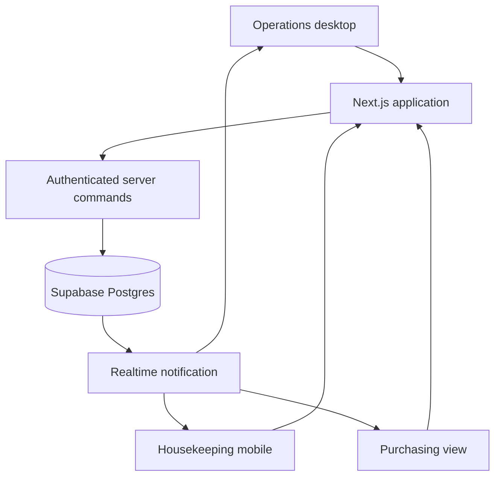

# RoomReady — Product Requirements & Implementation Plan

**Version:** 1.0 (proposal prototype)  
**Date:** 23 October 2026  
**Proposal presentation:** 26 October 2026  
**Prepared for:** VSPH exploratory solution proposal to Taj Santacruz, Mumbai  
**Development:** Ayan Khan and Hardik  
**Status:** Planning only; repository not yet initialized

> **Important:** This is a concept prototype, not software commissioned or approved by Taj/IHCL. Use fictional hotels, staff names, room records, inventory quantities, and costs. Do not present demo data as hotel records or imply an integration with an existing property-management system (PMS).

## 1. Executive Summary

RoomReady is a mobile-friendly **visual room-readiness and housekeeping workflow dashboard** for hotel operations. Staff can scan a seat-map-like grid of rooms grouped by floor, see what requires attention, assign and complete housekeeping tasks, and release rooms after supervisor inspection. The purchasing extension demonstrates how recorded use of linen and room amenities can trigger low-stock alerts and purchase requests.

The demo should answer two questions:

1. **Operations:** Can the hotel shorten the time between checkout and a room being ready for the next guest?
2. **Purchasing:** Can room turnover information expose consumables usage and replenishment needs sooner?

The visual concept follows `RoomReady_Taj_Santacruz_DESIGN.md`: warm ivory, deep ink, restrained provisional gold, optional ruby accents, readable semantic status colors, understated Art Deco touches. There is **no 3D view and no precise architectural floor plan**.

### Primary outcome for 26 October

Deliver a believable **two-device workflow**: desktop reception/operations view and mobile housekeeping view reflect the same room change, followed by a small purchasing stock alert. A protected, deployed demo URL and a 2–3 minute walkthrough are preferred to a large feature list.

## 2. Stakeholders, Users and Roles

| Role | Primary task | Scope of demo permission |
|---|---|---|
| Operations manager | Monitor floors, prioritize and assign tasks, review exceptions | Read rooms; assign/reassign tasks; view logs |
| Housekeeping staff | See assigned work, start/finish cleaning, record supplies used | Read assigned tasks; update own task progress |
| Housekeeping supervisor | Verify a completed clean; approve or reject | Inspect and approve/reject rooms |
| Front desk | Check vacant/ready rooms; manually record check-in/check-out | Read room status; perform manual occupancy transitions |
| Purchasing manager | Review low-stock alerts, create/approve simulated requests | Read stock; manage request status |
| Demo administrator | Reset fictional scenario and accounts | Demo reset only; no production role |

**No public guest-facing booking in the MVP.** The airline-seat-map comparison refers to the *visual clarity of selection*, not giving guests control over occupancy or housekeeping states.

## 3. Scope

### Must-have (MVP)

- [ ] Polished desktop operations screen with grouped, selectable room tiles.
- [ ] Room occupancy, housekeeping and maintenance represented as separate dimensions.
- [ ] Color-coded status with text, icon/marker, legend and filters.
- [ ] Room detail panel showing state, assignee, priority, timestamps and next allowed action.
- [ ] Housekeeping task queue with assignment, start and finish actions.
- [ ] Mobile task screen with a short cleaning checklist.
- [ ] Supervisor inspection approval and rejection.
- [ ] Multi-device state synchronization or immediate refetch after change.
- [ ] At least one inventory item, recorded consumption, stock threshold alert and purchase request.
- [ ] Fictional seed data, resettable scenario and clear `Demo data` disclosure.
- [ ] Basic authentication and protected role-specific actions.
- [ ] Deployed URL, tested end-to-end demonstration and fallback screenshots/video.

### Should-have if time remains

- [ ] Room search, floor selector, status filter and urgent-arrival flags.
- [ ] Task assignment note, rejection reason and recent activity log.
- [ ] Summary counts: ready / dirty / cleaning / inspection / blocked.
- [ ] Maintenance hold/release by an authorized manager.
- [ ] Small purchasing approval history panel.
- [ ] Optimistic UI with rollback on conflict; only after safe server transitions work.

### Explicitly out of scope for the proposal build

- Hotel PMS/channel-manager integration, live OTA booking, payments or billing.
- Guest identities, passports, phone numbers, booking details or real employee data.
- Precise hotel architecture, indoor navigation, IoT sensors, smart locks or 3D rendering.
- Automatic occupancy inference; check-in/check-out is manually simulated.
- AI staffing forecasts, dynamic pricing, vendor scorecards, invoice OCR and complete procurement ERP.
- Automated supplier orders or purchases with real money.
- Production-grade multi-property infrastructure or a replacement for existing hotel software.

## 4. Functional Requirements

| ID | Priority | Requirement | Acceptance test |
|---|---|---|---|
| FR-01 | P0 | Room rack shows rooms grouped by logical floor | Floor selector changes the visible room set without implying a physical plan |
| FR-02 | P0 | Every tile shows room number + readable room status | User can identify a dirty and a ready room without opening details or relying on color alone |
| FR-03 | P0 | Room details keep occupancy, housekeeping and maintenance separate | Occupied+clean and vacant+out-of-order both display correctly |
| FR-04 | P0 | Room state is derived from persisted data | KPI totals, queue and room details agree after updates |
| FR-05 | P0 | Operations manager assigns a cleaning task | Assignee sees the task in mobile queue |
| FR-06 | P0 | Cleaner starts and completes cleaning checklist | Room moves from dirty → cleaning → inspection pending |
| FR-07 | P0 | Supervisor approves or rejects inspection | Approval produces `clean/ready`; rejection sends room back to dirty with reason |
| FR-08 | P0 | Two connected clients see updates | Desktop reflects a phone update without manual hard refresh, or reconnects/refetches reliably |
| FR-09 | P0 | Out-of-order maintenance blocks assignment | The system never offers the room as assignable, even when housekeeping is clean |
| FR-10 | P0 | Inventory usage can be recorded against a cleaning task | A stock movement decrements a fictional SKU once, not twice on repeated submission |
| FR-11 | P0 | Stock threshold triggers alert | Low-stock callout appears when available count is at/below configured threshold |
| FR-12 | P0 | Purchasing request can be created and approved | Request has a status history; no external purchase is placed |
| FR-13 | P0 | Demo seed/reset is controlled | Administrator can return to initial sample state; ordinary users cannot reset |
| FR-14 | P1 | Priority and arrival deadlines can be viewed | Task queue sorts urgent arrival cases first |
| FR-15 | P1 | Activity history records actor/time/action | A changed room has auditable previous/next states |
| FR-16 | P1 | Filters and search work on the actual data | State/floor/search results and counts stay consistent |

## 5. State Model and Business Rules

### 5.1 Separate state dimensions

```text
occupancy:    vacant | occupied
housekeeping: clean | dirty | in_progress | pending_inspection
maintenance:  clear | out_of_order
```

**Computed assignability** (used by front desk):

```text
assignable = occupancy == vacant
          AND housekeeping == clean
          AND maintenance == clear
```

The public-friendly tile label is a **projection**, not a single database enum:

1. Maintenance `out_of_order` → **Out of order** (highest precedence; never assignable).
2. Occupancy `occupied` → **Occupied** (housekeeping condition still available in details).
3. Vacant + housekeeping `dirty` → **Needs cleaning**.
4. Vacant + housekeeping `in_progress` → **Cleaning**.
5. Vacant + housekeeping `pending_inspection` → **Awaiting inspection**.
6. Vacant + housekeeping `clean` + maintenance `clear` → **Ready**.

### 5.2 Allowed workflow

| Action | Who | Required current state | New state / effect |
|---|---|---|---|
| Check out (manual simulation) | Front desk | Occupied, no conflicting pending checkout | Occupancy → vacant; housekeeping → dirty; create cleaning task |
| Assign cleaner | Manager | Open cleaning task | Task assigned to staff member |
| Start cleaning | Assigned cleaner | Dirty room, assigned task | Housekeeping → in_progress; task → in_progress |
| Finish checklist | Assigned cleaner | In progress, checklist complete | Housekeeping → pending_inspection; task → pending_inspection |
| Approve inspection | Supervisor | Pending inspection | Housekeeping → clean; task → completed |
| Reject inspection | Supervisor | Pending inspection | Housekeeping → dirty; task → needs_rework; save reason |
| Mark out of order | Authorized manager | Any state | Maintenance → out_of_order; assignability blocked |
| Clear maintenance hold | Authorized manager | Out of order | Maintenance → clear; housekeeping is **not** automatically made clean |
| Check in (manual simulation) | Front desk | Computed assignable = true | Occupancy → occupied |

For the **proposal demo**, simulate these actions using clearly labeled sample rooms. Actual check-in/out authority, room release rules and inspection policy must be confirmed during follow-up discovery.

### 5.3 Consistency and race conditions

- Room updates must be **server-validated** with the current state and actor's role. Do not rely on hiding a button.
- Store an integer `version` on each room state. Mutations send `expected_version`; a stale update returns HTTP `409` and the client refetches.
- Task, room state and audit event must change **atomically** (transaction/database function), preventing divergent views.
- Deduct inventory through an idempotent stock movement keyed to the task and item to avoid double consumption.
- Realtime is a UI enhancement, not the source of truth: refetch on reconnect, after a mutation and when the tab regains focus.
- Timestamps stored in UTC, displayed in the hotel's time zone (Asia/Kolkata).

## 6. Screens and User Experience

### Screen A — Operations overview `/overview`

1. Taj-inspired dark-ink top/side navigation (brand treatment is provisional).
2. Property label, current date, floor/wing selector and `Demo mode` tag.
3. KPI row: `Ready`, `Needs cleaning`, `Cleaning`, `Awaiting inspection`, `Out of order`.
4. **Room rack:** grid of numbered rectangular tiles with pale state fills and readable labels; no 3D or architectural claim.
5. Room detail drawer: three underlying states, assignee, cleaning stage, activity history and available action.
6. Priority task queue: room, staff, deadline/urgency and stage.
7. Compact low-stock signal linking to purchasing.

### Screen B — Housekeeping mobile `/my-tasks`

- Card list sorted by task priority and due time.
- Each task: large room number, task stage, checklist, short note, and one obvious next action.
- Actions: `Accept` (if assigned), `Start cleaning`, check items, `Submit for inspection`.
- Display actionable errors when another user already changed the task.
- No horizontal scrolling or miniature dashboard grid on narrow screens.

### Screen C — Supervisor inspection `/inspections`

- List of rooms pending inspection.
- Detail checklist summary and previous cleaner.
- `Approve` or `Reject`, with mandatory reason on rejection.
- Approve moves the room to ready **only if** vacant and maintenance-clear; if blocked/occupied the housekeeping state becomes clean but tile does not claim assignability.

### Screen D — Purchasing extension `/inventory`

- Items: `Guest amenity kit`, `Linen set`, `Cleaning solution` (illustrative).
- On-hand quantity, unit, low-stock threshold and recent movements.
- From a room task, staff explicitly record supplies used; do not assume every room consumes the same amount.
- Below-threshold alert invites `Create purchase request`.
- Request status `pending → approved/rejected` is internal demonstration only, **no vendor ordering**.

### Screen E — Simple presentation entry `/demo` (optional)

- Three large pathways: `Operations`, `Housekeeping`, `Purchasing`.
- One-sentence scenario and link to demo reset (restricted).
- Omit if the workflow can be introduced cleanly from `/overview`.

## 7. Design Requirements

**Source document:** `RoomReady_Taj_Santacruz_DESIGN.md`.

| Area | Required direction |
|---|---|
| Brand framing | Warm ivory `#F8F6F1`, deep ink `#29251F`, provisional heritage gold `#8E744B` |
| Status colors | Green ready; blue occupied; red dirty; amber cleaning; violet inspection; gray blocked |
| Distinctive quality | Refined editorial headings, restrained Art Deco fine lines, quiet card surfaces |
| Room visualization | Airline-seat-map-like, data-oriented logical room grid |
| Interaction | Tile selection, room detail, state filter, meaningful feedback after authorized action |
| Accessibility | Status text plus color, keyboard focus, AA contrast, mobile touch targets ≥44 px |
| Responsiveness | Dashboard-first desktop, task-first mobile |
| Branding rights | Taj/IHCL logo/images only if explicitly approved; otherwise use neutral concept wordmark |

Gold is for framing and selected actions; it must never replace the semantic red/green/amber room-state language.

## 8. Technical Architecture

### Recommended stack

| Layer | Choice | Reason |
|---|---|---|
| Frontend/framework | Next.js App Router + TypeScript | Familiar to Ayan; route organization, server and interactive client components |
| Styles/UI | Tailwind CSS + accessible components (e.g. shadcn/ui primitives) | Fast, coherent visual implementation |
| Data/auth | Supabase Postgres + Supabase Auth | Single hosted database and demo accounts |
| Multi-client updates | Supabase Realtime + refetch/reconnect fallback | Changes visible between mobile and desktop while DB remains authoritative |
| Validation | Zod schemas at server boundary | Typed and validated commands |
| Deployment | Vercel for web; Supabase-hosted database | Practical shareable URL for client review |
| Tests | Vitest for state rules; Playwright for full demo flow | Catches invalid transitions and user-facing regressions |

**Architecture flow:**



Implementation notes:

- Server components can load initial dashboard data. Client components own tile selection, filters, task actions and realtime subscriptions.
- Mutations go through authenticated server handlers/RPC; role checks must occur **server-side**. Never expose a service-role secret in browser code.
- Enable RLS on exposed Postgres tables and deny unauthenticated data access. Do not use an open anonymous write policy just to simplify the demo.
- Subscribe only to the relevant property/table changes. Refetch current room/task records after a realtime event to avoid stale derived counts.
- Handle Supabase/hosting cost and limits during setup; the plan does not assume any particular free-tier entitlement.

Relevant official documentation:

- Next.js App Router: https://nextjs.org/docs/app
- Server vs. Client Components: https://nextjs.org/docs/app/getting-started/server-and-client-components
- Supabase RLS: https://supabase.com/docs/guides/database/postgres/row-level-security
- Supabase changes: https://supabase.com/docs/guides/realtime/postgres-changes

### 8.1 Deployment fallback

If the live backend cannot be stabilized by the end of 25 October, present a **clearly labeled local/simulated demo** with seeded data and deterministic frontend transitions, plus a recorded multi-screen walkthrough. Never claim real live synchronization, audit security or PMS integration when they are not implemented.

## 9. Data Model (MVP)

| Table | Important fields | Notes |
|---|---|---|
| `properties` | id, name, timezone | One fictional Taj-inspired sample property; easily configurable |
| `rooms` | id, property_id, floor, number, category, active | Stable room identity; unique (property_id, number) |
| `room_states` | room_id, occupancy, housekeeping, maintenance, version, updated_at, updated_by | Source of truth; one per room |
| `profiles` | user_id, display_name, role, property_id | Links authenticated demo users to role; no guest PII |
| `housekeeping_tasks` | id, room_id, assignee_id, priority, due_at, status, checklist_json, created_at, completed_at | Task progress and historical records |
| `inspection_results` | id, task_id, inspector_id, outcome, rejection_reason, created_at | Supervisor decisions |
| `room_events` | id, room_id, actor_id, action, before_json, after_json, created_at | Append-only demo audit log |
| `inventory_items` | id, property_id, sku, name, unit, on_hand, reorder_threshold | Synthetic stock quantities |
| `stock_movements` | id, item_id, task_id, quantity_delta, actor_id, reason, idempotency_key, created_at | Prevents duplicate deductions |
| `purchase_requests` | id, property_id, item_id, quantity, requested_by, approved_by, status, timestamps | Internal mock approvals only |

Use UUID primary keys (or stable IDs); store room number separately. Add foreign keys, enums/check constraints, a `version` check, unique stock idempotency keys, and relevant indexes (`room_states.housekeeping`, `tasks.assignee_id`, `tasks.status`). Keep DB migrations committed alongside code. Persist only necessary fictional data.

## 10. API / Action Contract

Final HTTP/RPC naming is flexible, but establish one contract before Ayan and Hardik work in parallel.

| Action | Input | Result |
|---|---|---|
| `GET /api/rooms?floor=4` | Authenticated user, optional floor | Rooms with all state fields and version |
| `GET /api/tasks?scope=mine` | Authenticated user | Role-filtered tasks |
| `POST /api/tasks/:id/assign` | assignee_id, expected_version | Assigned task or validation conflict |
| `POST /api/rooms/:id/transition` | action, expected_version, optional task_id/reason | Validated atomic room/task update + new version |
| `POST /api/tasks/:id/checklist` | Checklist item updates | Saved checklist status |
| `POST /api/inspections/:taskId/decision` | approve/reject, rejection reason | Inspection result + room/task transition |
| `GET /api/inventory` | Authenticated purchasing/manager user | Stock + alerts |
| `POST /api/inventory/movements` | task_id, item_id, used_qty, idempotency_key | Recorded decrement or no-op duplicate |
| `POST /api/purchase-requests` | item_id, quantity, rationale | New pending request |
| `POST /api/purchase-requests/:id/decision` | approve/reject | Approval history updated |
| `POST /api/demo/reset` | Demo admin only | Restored initial synthetic records |

Example transition payload:

```json
{
  "action": "START_CLEANING",
  "taskId": "example-task-uuid",
  "expectedVersion": 3
}
```

All handlers return a structured validation error on invalid role/state or missing input. A state-version conflict uses `409 Conflict` with the latest state reference; the UI explains that the room was updated elsewhere.

## 11. Repository Layout (to create later)

```text
roomready-hospitality-demo/
├── README.md
├── docs/
│   ├── IMPLEMENTATION_PLAN.md
│   ├── DESIGN.md
│   └── DEMO_SCRIPT.md
├── src/
│   ├── app/
│   │   ├── (auth)/
│   │   ├── (dashboard)/overview/
│   │   ├── (dashboard)/my-tasks/
│   │   ├── (dashboard)/inspections/
│   │   ├── (dashboard)/inventory/
│   │   └── api/
│   ├── components/
│   │   ├── room-rack/
│   │   ├── housekeeping/
│   │   ├── inventory/
│   │   └── shared/
│   ├── lib/
│   │   ├── auth/
│   │   ├── db/
│   │   ├── validation/
│   │   └── room-state/
│   └── types/
├── supabase/
│   ├── migrations/
│   └── seed.sql
├── tests/
│   ├── unit/
│   └── e2e/
└── .env.example
```

The repository name is deliberately generic while Taj remains a prospective, not confirmed, client. Never commit secrets or `.env.local`. Include `.env.example`, a README, screenshots (if licensed), installation, demo credentials delivery instructions and data reset steps.

## 12. Collaboration and Ownership

| Owner | Primary files/area | Deliverables |
|---|---|---|
| **Ayan** | Dashboard screens, shared visual components, theme, responsive behavior | Room rack, detail panel, filters, mobile views, purchasing UI, UI tests |
| **Hardik** | Supabase schema/migrations, auth, server actions, seed data | Correct transitions, API handlers, realtime subscription contract, security rules, DB tests |
| **Both** | Data contract, integration, demo rehearsal | Approved enums/contract on Day 1; end-to-end flows on Day 2–3 |

To avoid merge conflicts:

1. Agree on TS data types, API inputs and state transitions **before** parallel implementation.
2. Hardik owns `supabase/` and `src/app/api/`; Ayan owns `src/components/` and visual page files.
3. Put shared API/client types under `src/types/`; change them only through a reviewed contract commit/PR.
4. Use short feature branches and PRs into a shared `dev` branch; promote a tested version to `main` for deployment.
5. Do not both edit global style/theme tokens, dependency manifests or migration files at the same time.

**Proposed branches after repo creation:** `feat/design-system-room-rack`, `feat/room-state-api`, `feat/housekeeping-mobile`, `feat/inventory-purchase-alert`. Repository creation and initial commits are **not** part of this planning phase.

## 13. Three-Day Milestones

| Date | Target | Exit criterion |
|---|---|---|
| **23 Oct — Foundation** | Repo bootstrap later; dependencies; design tokens; room models; DB migration + seed; first static rack | Browser displays synthetic rooms; state contract agreed; no real data |
| **24 Oct — End-to-end operations** | Assign, start, finish, inspect; mobile tasks; auth/role checks; realtime or refetch | A phone action changes the corresponding desktop room and cannot skip inspection |
| **25 Oct — Purchasing + polish** | Record stock consumption; alert/request; responsive QA; reset; smoke tests; deployment | Full 2–3 minute demo rehearsed with no blocking errors |
| **26 Oct — Proposal** | Freeze demo; capture backup video/screenshots; show workflow and discuss real problems | Stakeholders understand problem solved, data assumptions, integrations and next step |

If development starts late, prioritize the room rack + cleaning/inspection lifecycle and one stock-alert example. Do not compromise state correctness to add unverified charts or AI.

## 14. Testing and Acceptance

### Required unit tests

- Ready state requires `vacant + clean + maintenance-clear`.
- An occupied clean room is not assignable.
- Out-of-order status overrides the displayed tile status without destroying housekeeping data.
- Cleaner cannot approve their own inspection using cleaner role.
- Invalid `dirty → clean` shortcut is rejected.
- Stale `expectedVersion` is rejected and correct latest state is returned.
- Duplicate stock consumption idempotency key does not decrement twice.
- Purchase request cannot be approved by unauthorized staff.

### Required E2E walkthrough

1. Front desk checks out synthetic Room 402; it becomes vacant + dirty and appears in queue.
2. Manager assigns Room 402 to Cleaner A.
3. Cleaner A opens phone view, starts cleaning, checks tasks, records two amenity kits, submits.
4. Desktop room tile changes to **Awaiting inspection**.
5. Supervisor approves; Room 402 becomes **Ready**. Front desk can select it for manual check-in.
6. Inventory panel displays reduced kits, crossing a preconfigured threshold; a purchase request is created and approved.
7. Repeat with `reject inspection` and `maintenance out of order` to show safe edge-case handling.
8. Reset the demo; initial counts and sample events return deterministically.

### Non-functional acceptance

- Works on common laptop desktop widths and a ~390 px smartphone viewport.
- Status remains discernible in grayscale and to keyboard users; clear labels and visible focus.
- No browser console errors or critical accessibility violations in the walkthrough.
- Every mutation has loading, success and error feedback.
- Network reconnection refetches current room data.
- Demo data and provisional branding are visibly disclosed.
- Room/readiness counts always match DB-derived states.

## 15. Demo Script (2–3 Minutes)

**00:00–00:30 — Problem:** “A room is checked out, but housekeeping, front desk and purchasing may not have one shared operational view.” Show the room rack and state legend.

**00:30–01:30 — Operations:** Check out a fictional room, assign cleaner, then update it from a mobile view. Supervisor approves; room visibly becomes ready on desktop. Emphasize role-based handoff.

**01:30–02:10 — Purchasing:** Record use of room supplies; show inventory count/threshold and generate an internal purchase request. Clarify this does not place a real order.

**02:10–03:00 — Next step:** Ask which existing PMS, housekeeping and procurement systems the hotel uses; request baseline turnaround/stock data and determine whether an integration, workflow overlay or purchasing-first pilot offers the best value.

Avoid invented savings percentages. Present potential metrics for a real pilot: **median checkout-to-ready time**, pending rooms near check-in, re-inspection rate, stockout incidents, and purchase-request approval time.

## 16. Risks, Dependencies and Discovery Questions

| Risk / unknown | Implication | Mitigation |
|---|---|---|
| Current hotel PMS and housekeeping process unknown | Existing software may already solve much of this | Ask for current tool and actual bottleneck before suggesting replacement |
| Purchasing is contact's responsibility | RoomReady alone might not resonate | Include a real purchasing event in the story, but keep it lightweight |
| Official brand colors/logos unconfirmed | Inaccurate branding or trademark issues | Use provisional Taj-inspired visual tokens; request approved assets |
| Multi-user conflicting changes | Incorrect room availability | Validated atomic transitions + version checks |
| Realtime connection drops | Dashboard becomes stale | Refetch on reconnection/focus and after mutations |
| Procurement stock linkage not established | Unrealistic automatic deductions | Model explicit staff-recorded consumption; validate with client |
| Short timeline / two contributors | Integration and UX polish at risk | Freeze P0 scope; reserve 25 Oct for complete rehearsal |
| Hosting/auth setup | External dependencies can block deployment | Test early; prepare clearly identified recorded fallback |

### Questions for Bwhwiti / client follow-up

1. Which PMS/housekeeping/ERP/procurement platforms do you currently use?
2. How does reception know a room is inspected and ready now? What causes delays?
3. Are cleaning assignments issued through software, paper or messaging apps?
4. Who can change room status, mark out-of-order, or approve inspection?
5. Are amenity/linen stocks tracked by room, floor, department or central store?
6. What is the highest-friction purchasing approval or vendor issue today?
7. Which two measurable outcomes would make a 4–6 week pilot worthwhile?
8. Can Taj/IHCL provide approved logo/colors and authorize a private concept demonstration?

## 17. Definition of Done

The prototype is ready to demonstrate when:

- [ ] All critical room state transitions work and prevent unauthorized shortcuts.
- [ ] A room updates correctly from mobile and desktop with reliable refresh fallback.
- [ ] At least one purchasing alert and internal request are demonstrable.
- [ ] Visual style follows the agreed luxury hotel design tokens without compromising status clarity.
- [ ] Fictional records, proprietary boundaries and unimplemented integrations are plainly disclosed.
- [ ] Tests pass; public link requires authentication; no secret is checked in.
- [ ] Demo reset and backup walkthrough are prepared.
- [ ] Ayan and Hardik have rehearsed the full script at least twice.

## 18. Next Decision — Before Repository Initialization

Confirm that the VSPH team wants **RoomReady + the narrow purchasing extension** as the first client prototype. Then create a neutral-name GitHub repository (suggested: `roomready-hospitality-demo`), add this implementation plan and the design specification under `docs/`, agree on roles/contract, and open the first milestone issues. **Do not create the repo until that follow-up step is explicitly requested.**
